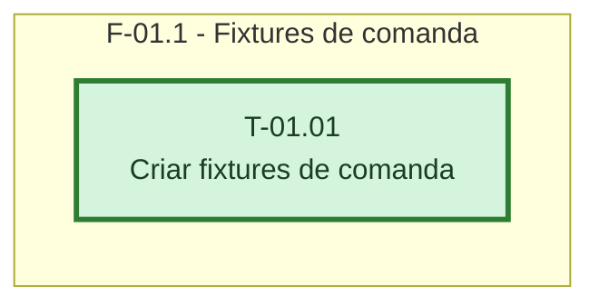

# Fases - Sprint 01

## F-01.1 - Fixtures de comanda

**Objetivo:** Disponibilizar dados de teste coerentes para API e interface.

**Tasks que a compoem:** T-01.01

**Criterio de saida:** Fixture cobre aberta, caixa fechado e permissoes separadas.

**Roda em paralelo com:** nenhuma
