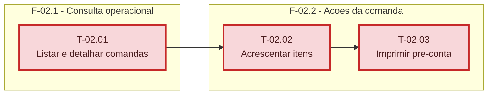

# Fases - Sprint 02

## F-02.1 - Consulta operacional

**Objetivo:** Consultar comandas abertas sem herdar o filtro Hoje.

**Tasks que a compoem:** T-02.01

**Criterio de saida:** Lista e detalhe retornam somente comandas abertas, mais antigas primeiro.

**Roda em paralelo com:** nenhuma

## F-02.2 - Acoes da comanda

**Objetivo:** Acrescentar itens e imprimir pre-conta com os gates operacionais definidos.

**Tasks que a compoem:** T-02.02, T-02.03

**Criterio de saida:** Acrescimo respeita caixa e pre-conta nao reimprime cozinha.

**Roda em paralelo com:** nenhuma
