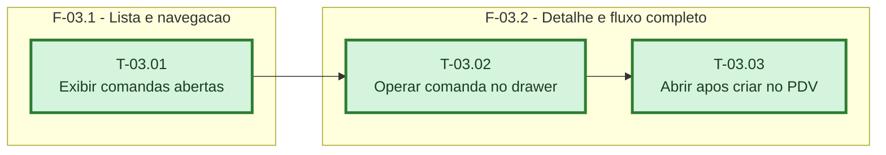

# Fases - Sprint 03

## F-03.1 - Lista e navegacao

**Objetivo:** Exibir comandas acima das mesas com contador e gates independentes.

**Tasks que a compoem:** T-03.01

**Criterio de saida:** Menu, contador e cards aparecem conforme as permissoes do operador.

**Roda em paralelo com:** nenhuma

## F-03.2 - Detalhe e fluxo completo

**Objetivo:** Operar a comanda e abrir o registro criado no PDV.

**Tasks que a compoem:** T-03.02, T-03.03

**Criterio de saida:** Drawer executa acoes e PDV abre a comanda criada sem repetir o POST.

**Roda em paralelo com:** nenhuma
